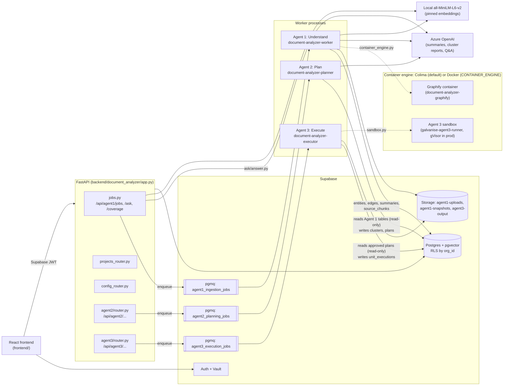
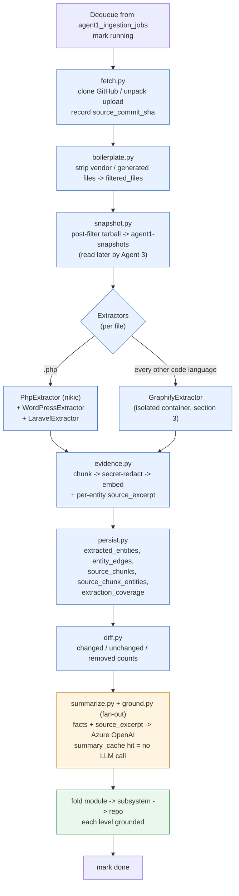
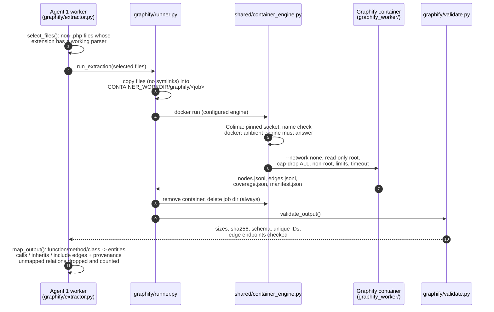
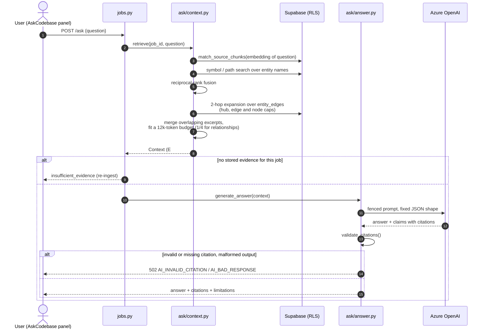
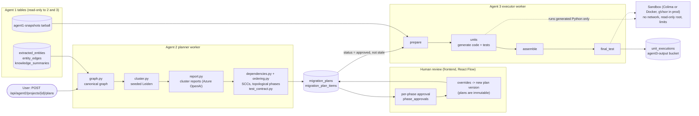
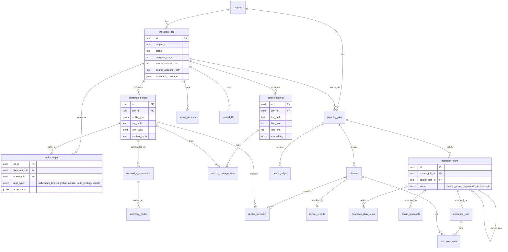

# Architecture overview

A one-page map of how the whole system fits together, drawn as Mermaid diagrams. It's an overview only: the authoritative detail lives in `design.md` (Agent 1, including §5a for Graphify and source evidence), `design_agent2.md` and `design_agent3.md`. If this page and a design doc disagree, the design doc wins; fix this page.

## 1. System overview

Three independent agents, each with its own pgmq queue and long-lived worker process. They never call each other; they only read and write shared Supabase tables. FastAPI only enqueues jobs and reads results; nothing long-running happens inside a request.

## 2. Agent 1 ingestion pipeline

`worker/run.py::process_job`, for one dequeued job. The `progress_stage` values are `extracting`, `summarizing` and `grounding`. A grounding failure flags the summary `unverified`; it never blocks the job.

Colours: blue is the `extracting` stage, orange is `summarizing`, green is `grounding`.

## 3. Graphify extraction (isolated, parse-only)

Graphify's tree-sitter parsers read hostile input, so they run in a disposable container rather than in the worker. Nothing from the repository is ever executed. Mode is set with `AGENT1_GRAPHIFY`:

- `auto` (default): skip and record `unavailable` if the container engine or the image is missing.
- `required`: fail the job instead.
- `off`: never run.

Once the container has actually run, any failure (timeout, OOM, invalid output) fails the job.

## 4. Cited Q&A: "Ask the codebase"

`POST /api/agent1/jobs/{job_id}/ask`. Retrieval is deterministic and runs on the caller's RLS-scoped client. The LLM only sees repository text inside random per-request fences, and may cite only the `E#` / `R#` IDs it was given.

## 5. Agent 2 (Plan) to Agent 3 (Execute)

The user starts planning. Only an approved, non-stale plan reaches Agent 3. Agent 3's stages are stubs until `tasks_agent3.md` Phases 2 to 4 land.

Agents 2 and 3 don't read `source_chunks`, edge `provenance`, or `inherits` edges yet. They do receive entities and edges for non-PHP repositories now that Graphify runs.

## 6. Data model (key tables)

Every table carries `org_id` with RLS. Worker writes use the service role, stamp `org_id` from the job row, and filter updates by `id` and `org_id`. The diagram omits `org_id`, `org_members`, `embedding_config` and `plan_overrides`.

## 7. Trust boundaries

- **No ingested code runs.** Agents 1 and 2 only parse the repository statically. Graphify's container parses a copy of the files; it doesn't execute anything. Agent 3 runs only the Python it generated, and only inside its sandbox. The worker never imports generated code in-process.
- **Repository text is untrusted in every prompt.** It is fenced or marked untrusted for summaries, grounding, cluster reports and Q&A. Q&A answers must cite supplied evidence, and a bad citation is rejected rather than shown.
- **Secrets are redacted.** Source chunks and excerpts go through `secret_scan.py::redact_text` before they're stored or sent anywhere. Findings go to `secret_findings`.
- **Code stays local for embeddings.** Embeddings use the pinned local MiniLM model. The only code sent to Azure OpenAI is an entity's own excerpt (in its summary call) and the retrieved Q&A context.
- **Containers run on one configured engine.** `CONTAINER_ENGINE=colima` (default) or `docker` (default on Windows); there is no fallback between them. Every container call goes through `shared/container_engine.py`. Run `uv run document-analyzer-doctor` to verify the setup.
